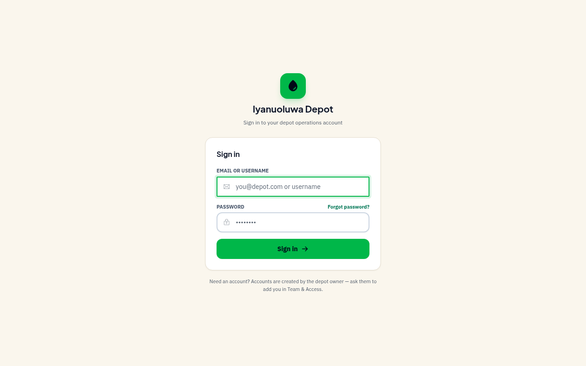
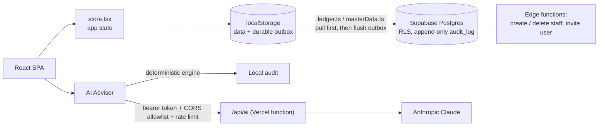

# Iyanuoluwa Digital Operations

**A depot sales ledger for a vegetable and palm oil depot in Lagos that replaces pen-and-paper with one app for truck intake, sales, pumps, kegs, customer credit and shift cash.**

**Live:** https://iyanuoluwa-vegetable-oil.vercel.app (staff sign-in required)



> Only the public sign-in page is shown. The signed-in screens hold the depot's real sales and customer records.

---

## The problem

A bulk oil depot sells by the litre, the keg and the pack. It does so on credit and in cash, across several pumps and tanks, and often with a patchy network. Paper ledgers made it hard to know how much oil was left in each tank, what each customer owed, whether pump meters matched sales, and whether the cash box matched the shift. This app records every one of those movements in one place, with an audit trail.

## Key features

Screens come from `src/constants/nav.ts`. Status comes from `MOSCOW.md`.

- **Truck intake**: record bulk tanker and pre-kegged deliveries, track litres left per tank, and flag shortfalls against declared tonnage.
- **New Sale**: click-first sales with several lines per sale, pack-size pricing (variety × pack size × tier), and split or double payment tenders.
- **Transaction ledger**: every sale, payment, expense, edit and void in one place, with who/what/when/why.
- **Customers and debt**: running balances, FIFO payment allocation across open sales, store credit, and printable or WhatsApp-shareable statements.
- **Pumps**: daily meter readings and per-day reconciliation, with a shift-opening gate that blocks bulk sales until every pump's opening reading is logged.
- **Kegs ledger**: loaned and purchased containers, returns, and outstanding kegs per customer.
- **Expenses and shift cash**: expected vs. counted cash per shift.
- **80 mm thermal receipts and waybills**, in commercial (with prices) and dispatch (contents only) formats.
- **Multi-hub, role-based access**: owner, staff and hub-manager roles, plus per-user screen access.
- **AI Advisor**: an operations audit and copilot. It runs a local deterministic engine and can use Anthropic Claude through a server-side proxy. It refuses to invent rates or forecasts when the data is missing.
- **Africa/Lagos timestamps everywhere**, with support for backdating late entries.

## Tech stack

| Layer | Tools |
| --- | --- |
| Frontend | React 18, TypeScript, Vite 6, Tailwind CSS 3, Phosphor Icons |
| Data | Supabase (Postgres, Auth, Storage, Edge Functions) with a localStorage mirror |
| Serverless | Vercel function `api/ai.ts`, an AI proxy to Anthropic Claude |
| Testing / QA | `tsx` unit test suites, Playwright + `@axe-core/playwright` |
| CI | GitHub Actions (typecheck, API typecheck, tests, build), plus a pre-commit hook |

## Architecture



## Notable engineering decisions

Each item below is backed by code in this repo.

- **Money and quantities are stored as `NUMERIC`.** Rates and prices use `numeric(12,2)`, credit limits `numeric(14,2)` and tonnage `numeric(10,3)` (`supabase/migrations/0001_init.sql`).
- **Row-level security on every table**, scoped by role and by hub (`0002_auth_rls.sql`, `0004_multi_hub_hubs.sql`, `0008_relational_hardening.sql`). Write access mirrors the client's own `canOperate()` permission model (`0011`).
- **An append-only audit trail.** `audit_log` has SELECT and INSERT policies but no UPDATE or DELETE policy, so RLS stops anyone from rewriting history (`0020_pack_prices_and_audit_log.sql`).
- **Offline mirror with a durable outbox** (`src/services/ledger.ts`, `masterData.ts`). Every change is queued in localStorage and removed only after the database confirms it. Sync pulls first so the database wins on conflicts, then pushes local-only rows one at a time. The outbox flushes in foreign-key order, and nothing is ever deleted remotely.
- **Gated on a schema probe.** If the database's migrations haven't been applied yet, the sync layer stays idle and runs device-only instead of retrying failed writes forever.
- **A blank price means "not priced", never ₦0.** An empty price cell deletes the `pack_prices` row, so the counter can't sell a pack for free.
- **Hardened AI proxy.** The Claude key stays on the server. The proxy checks a bearer token and a CORS allowlist and rate-limits each IP (20 requests per 10 minutes).
- **A read-only production QA suite.** Playwright tests block every non-GET request to Supabase, and share tokens are kept out of reports (`playwright.config.ts`, `tests/support/qa.ts`).

## Running locally

**Prerequisites:** Node.js 20+. Supabase is optional: without it, the app runs fully on localStorage.

```bash
npm install            # also sets git hooks via the `prepare` script
cp .env.example .env   # fill in your own values; .env is git-ignored
npm run dev            # Vite dev server; it also emulates /api/ai locally
```

Environment variables (see `.env.example` for full notes):

| Variable | Where | Purpose |
| --- | --- | --- |
| `VITE_SUPABASE_URL`, `VITE_SUPABASE_ANON_KEY` | Browser | Supabase project (anon key only) |
| `ANTHROPIC_API_KEY` (or `CLAUDE_API_KEY`) | Server only | Claude for the AI Advisor |
| `AI_PROXY_TOKEN` / `VITE_AI_PROXY_TOKEN` | Server / browser | Shared bearer token for `/api/ai` |
| `AI_ALLOWED_ORIGINS` | Server only | CORS allowlist for `/api/ai` |
| `SUPABASE_DB_URL` | Dev machine only | Applying migrations with the Supabase CLI or psql |
| `BASE_URL`, `QA_USERNAME`, `QA_PASSWORD`, `QA_READ_ONLY`, `QA_MAX_SCREENS` | `.env` only | Playwright QA against a deployed build |

Database: apply `supabase/migrations/0001_…` to `0025_…` in order. `supabase/SCHEMA.md` documents each one. `npm run check:sync` signs in as the owner and reports which tables the app can actually reach in a live project.

## Tests

```bash
npm test               # unit suites: nav, business logic, master data + validation, auth, ledger, AI engine
npm run typecheck      # tsc --noEmit
npm run typecheck:api  # serverless function types
npm run qa             # Playwright: smoke, links, images, accessibility (axe), responsive. Needs BASE_URL
```

CI (`.github/workflows/ci.yml`) runs the typecheck, the API typecheck, the tests and the build on every push and pull request. The pre-commit hook runs the typecheck and tests. See `QA_REPORT.md` for the latest QA pass on the deployed build.

## Project history

130 commits since September 2026 (from `git log`). Requirements and priorities are in `MOSCOW.md`. The UI brief and mockups are in `STITCH-UI-BRIEF.md` and `design/stitch/`.

---

**Role:** built by **Sanni-Musa Emmanuel George**, full-stack developer and designer, Lagos.
[github.com/geosan11](https://github.com/geosan11) · [linkedin.com/in/george-sanni-musa-92b699195](https://www.linkedin.com/in/george-sanni-musa-92b699195)
